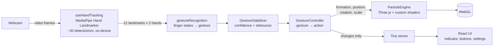

<div align="center">

# Airchemy

**Real-time, gesture-controlled 3D particle engine — in your browser.**

*Pronounced AIR-kuh-mee · air + alchemy*

Raise your hand to the webcam and thousands of glowing particles transform into a
crackling plasma sphere, a butterfly, a blooming lotus, Saturn, a galaxy or a beating heart.
No installs, no accounts, no servers: everything runs on your device.


</div>

---

## Contents

- [Features](#features)
- [The six formations](#the-six-formations)
- [Gestures](#gestures)
- [Quick start](#quick-start)
- [How it works](#how-it-works)
- [Project structure](#project-structure)
- [Privacy](#privacy)
- [Performance](#performance)
- [Testing](#testing)
- [Troubleshooting](#troubleshooting)
- [Deploying to Vercel](#deploying-to-vercel)
- [Credits and licences](#credits-and-licences)

---

## Features

- **Hand tracking in real time.** Up to two hands, 21 landmarks each, using Google's MediaPipe Hand Landmarker running locally in the browser (WebAssembly + GPU).
- **Six 3D particle formations,** each generated mathematically, with its own colour palette and idle animation.
- **Smooth morphing.** Particles fly from one shape to the next, and colours blend along the way.
- **Gesture control.** Switch shapes, resize, move, rotate, expand with two hands, and trigger a "Big Bang" explosion.
- **Reliable recognition.** Gestures are smoothed, confidence-checked and debounced, so shapes don't flicker while your hand moves.
- **Adaptive performance.** The particle count adjusts automatically to keep the frame rate smooth.
- **Works without a camera.** Every shape can be selected from the buttons at the bottom.
- **Customisable.** Particle count, size, speed, intensity, background, camera preview and hand skeleton. Settings are remembered in your browser.
- **Private by design.** Video never leaves your device.

## The six formations

| Formation | Name | Look | Motion |
|---|---|---|---|
| Sphere | **Electric Plasma** | Electric-blue shell, cyan currents, violet lightning bolts, white-hot core | Surface waves and electric crackle |
| Butterfly | **Mystic Wings** | Teal body, blue → purple → magenta wings, violet veins, curled antennae | Flapping wings and a gentle bob |
| Lotus | **Divine Blossom** | Four rings of rose-to-pink petals, golden seed pod, ripples beneath | Petals breathe; pollen drifts upward |
| Saturn | **Golden Orbit** | Bronze and gold banded planet, ringlets with a Cassini gap | Rings orbit, inner rings faster (like Kepler's laws) |
| Galaxy | **Cosmic Infinity** | Indigo rim, blue and purple arms, pink star regions, warm core | The disc slowly turns |
| Heart | **Eternal Love** | A true 3D heart: crimson surface, glowing pink core | Lub-dub heartbeat; embers rise |

## Gestures

Hold a gesture for a moment (about a fifth of a second) and keep your palm facing the camera.

| Gesture | Action |
|---|---|
| ✊ Closed fist | Electric Plasma |
| ✌️ Two fingers | Mystic Wings |
| 🤟 Three fingers (index, middle, ring) | Divine Blossom |
| 🖐️ Open palm | Golden Orbit |
| ✊ → 🖐️ Hold a fist, then burst it open quickly | **Big Bang**, which reforms as Cosmic Infinity |
| 🫶 Two-hand heart (index tips touching above, thumbs touching below) | Eternal Love |
| 👆 + 👍 Thumb and index in an "L" | Resize: close the gap to shrink, open it to grow |
| 🙌 Two hands apart / together | Expand / compress |
| Move your hand | Move the formation |
| Tilt your hand | Rotate the formation |

Gestures never fight each other: resizing never switches shape, and with two hands visible only the heart can change the formation.

## Quick start

**You need:** [Node.js](https://nodejs.org) 20 or newer, a modern browser (Chrome, Edge, Safari or Firefox) and, optionally, a webcam.

```bash
git clone https://github.com/chhavii27/airchemy.git
cd airchemy
npm install       # also copies the MediaPipe runtime into public/
npm run dev
```

Open **http://localhost:5173**, click **Start camera**, allow camera access, and raise your hand.

| Command | What it does |
|---|---|
| `npm run dev` | Start the development server with hot reload |
| `npm test` | Run the unit tests |
| `npm run lint` | Check the code with oxlint |
| `npm run build` | Create the production build in `dist/` |
| `npm run preview` | Serve the production build locally to test it |

## How it works



The work is split into four independent layers:

1. **Hand tracking** (`src/hooks/useHandTracking.js`). Starts the camera only when you click, loads the MediaPipe model from this site (not a third-party CDN) and runs detection about 30 times a second, independently of rendering. It stops every camera track when switched off.
2. **Gesture recognition** (`src/utils/gestureRecognition.js`). Pure functions. A finger counts as raised when its bones are lined up *and* its tip is further from the wrist than its middle joint. Everything is measured relative to the size of your hand, so it works close to or far from the camera, with either hand, and when tilted.
3. **Stabilisation** (`src/utils/gestureStabilizer.js`). A gesture must be seen continuously, with enough confidence, before it counts. Brief tracking losses are ignored, pinch is "sticky", and a fist that opens quickly is detected as a burst.
4. **Rendering** (`src/engine/ParticleEngine.js`). A plain JavaScript class outside React, so it never causes re-renders:
   - **One** `BufferGeometry` holds every particle's position and colour. It is only rebuilt when the particle count changes.
   - **Shapes are generated from maths** (`src/utils/particleShapes.js`): golden-angle spirals, the Temple Fay butterfly curve, parametric petals, an implicit 3D heart surface, and spiral arms.
   - **Morphing:** every frame each particle moves a fraction of the way to its target, based on elapsed time (exponential easing), so motion looks identical at 30 or 120 FPS and can be redirected mid-flight.
   - **Idle animations run on the GPU** in the vertex shader (`src/shaders/particleShaders.js`). Each one is weighted by how "present" its formation is, so animations cross-fade during morphs.

## Project structure

```text
airchemy/
├── public/mediapipe/        MediaPipe model (+ WASM runtime, copied on install)
├── scripts/
│   └── copy-mediapipe.mjs   Copies the WASM runtime from node_modules after npm install
├── src/
│   ├── components/          React UI (header, settings, webcam preview, guide…)
│   ├── controllers/
│   │   └── GestureController.js   Stable gestures → engine actions
│   ├── engine/
│   │   ├── ParticleEngine.js      Three.js renderer, morphing, Big Bang, adaptive density
│   │   └── morph.js               Frame-rate-independent morph step (pure, tested)
│   ├── hooks/               Camera + tracking, settings, fullscreen
│   ├── shaders/             GLSL vertex/fragment shaders
│   ├── state/stores.js      Tiny observable stores for high-frequency UI data
│   ├── utils/
│   │   ├── gestureRecognition.js  Landmarks → gestures (pure, tested)
│   │   ├── gestureStabilizer.js   Debouncing and burst detection (pure, tested)
│   │   ├── particleShapes.js      The six formations (pure, tested)
│   │   ├── palettes.js            Per-formation colour palettes
│   │   └── __tests__/             Vitest unit tests
│   ├── App.jsx
│   └── main.jsx
└── vercel.json              Caching and security headers for deployment
```

**Changing colours:** every formation's palette is a short list of hex colours in `src/utils/palettes.js`.

## Privacy

- Camera frames are processed **entirely on your device**. Nothing is uploaded, recorded or stored.
- The camera is only requested **after you click** *Start camera*.
- Stopping the camera stops every camera track, which turns off your camera's indicator light.
- A red **Camera active** badge is always visible while the camera is on, even if the preview is hidden.
- No accounts, no analytics, no backend. Settings are saved only in your own browser (`localStorage`).

## Performance

- Hand detection runs about 30 times per second, separately from the 60 FPS render loop.
- The particle engine uploads data to the GPU only while particles are moving, and allocates nothing per frame.
- **Adaptive density:** if the frame rate stays below 45 FPS, the engine uses 20% fewer particles; when it's smooth again, it slowly adds them back (up to your chosen maximum). Phones start with fewer particles.
- MediaPipe uses the GPU when available and falls back to the CPU automatically.

## Testing

```bash
npm test
```

85 unit tests cover the pure logic:

- **Gesture recognition:** every gesture, mirrored (other hand), tilted, near/far from the camera, partial data, and the two-hand heart and spread.
- **Stabiliser:** hold time, flicker rejection, confidence, dropouts, burst detection and sticky pinch.
- **Shapes:** correct buffer sizes, finite values, deterministic output, framing, genuine 3D depth, and shape-specific checks (sphere shell, Saturn's Cassini gap, heart proportions).
- **Morphing and colours:** convergence, no overshoot, frame-rate independence, palette maths.

## Troubleshooting

| Problem | Fix |
|---|---|
| **"Camera permission was denied"** | Click the 🔒 icon in the address bar → *Camera* → *Allow*, then refresh. On macOS also check *System Settings → Privacy & Security → Camera* for your browser. |
| **"The camera is busy"** | Close other apps using the camera (Zoom, FaceTime, Teams) and click *Try again*. |
| **"No camera was found"** | Connect a webcam, or use the formation buttons instead. |
| **Gestures aren't recognised** | Use good, even light; face your palm to the camera; keep your whole hand in view about an arm's length away; hold each gesture for a moment. |
| **Shapes switch unexpectedly** | Keep unused fingers clearly folded. Turn on *Hand skeleton* in settings to see what the tracker sees. |
| **Low FPS** | Leave *Auto performance* on, or lower *Count* in settings. Close other heavy tabs. |
| **Black screen / "3D rendering unavailable"** | Enable hardware acceleration in your browser settings, or try the latest Chrome. |
| **The camera doesn't work on a deployed site** | Browsers only allow the camera on `https://` or `localhost`. Vercel serves HTTPS automatically. |
| **`npm install` fails** | Check `node -v` shows 20 or newer. |

## Deploying to Vercel

Airchemy is a static site, so it needs no server and no environment variables.

1. Push the project to GitHub.
2. Go to [vercel.com/new](https://vercel.com/new) and import the `airchemy` repository.
3. Vercel detects **Vite** automatically (build command `npm run build`, output directory `dist`). Click **Deploy**.
4. Open the `https://….vercel.app` link and allow camera access.

Every push to `main` redeploys automatically. `npm install` runs `postinstall`, which copies the MediaPipe WebAssembly runtime into the build, so it always matches the installed package version.

## Credits and licences

| Library / asset | Use | Licence |
|---|---|---|
| [Three.js](https://threejs.org) | 3D rendering | MIT |
| [MediaPipe Tasks Vision](https://ai.google.dev/edge/mediapipe) and the Hand Landmarker model, by Google | Hand tracking | Apache 2.0 |
| [React](https://react.dev) | User interface | MIT |
| [Vite](https://vite.dev) | Build tool | MIT |
| [Tailwind CSS](https://tailwindcss.com) | Styling | MIT |
| [Lucide](https://lucide.dev) | Icons | ISC |
| [Inter](https://rsms.me/inter/) and [Space Grotesk](https://fonts.google.com/specimen/Space+Grotesk), via Google Fonts | Typography | SIL Open Font License 1.1 |
| [Vitest](https://vitest.dev), [oxlint](https://oxc.rs) | Testing and linting | MIT |

The butterfly uses Temple H. Fay's butterfly curve (1989); the heart uses the classic implicit 3D heart surface.
